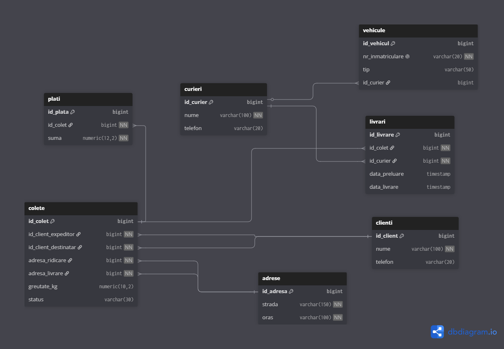

# Courier Company Database

A PostgreSQL database for a small courier company. I built it to practise relational modelling on something with a bit more going on than a typical "students and courses" example: clients, couriers, vehicles, addresses, parcels, deliveries and payments.

Table and column names are in Romanian (`clienti` = clients, `curieri` = couriers, `colete` = parcels, `livrari` = deliveries, `plati` = payments).

## How the data fits together

- a client can send many parcels
- every parcel has a sender and a recipient, both stored in `clienti`
- a courier can deliver many parcels
- each parcel has one delivery record and one payment

The full diagram is at the bottom of this page.

## What's in the repo

The files are numbered in the order they should be run:

| File | What it does |
|---|---|
| `1_schema.sql` | creates the tables, keys and constraints |
| `2_dummy_data.sql` | fills the tables with test data |
| `3_examples_queries_1.sql` | example queries (joins, aggregates) |
| `4_views.sql` | views, e.g. delivery details and per-courier statistics |
| `5_functions.sql` | functions such as total revenue or number of deliveries for a courier |
| `6_procedures.sql` | procedures for adding a parcel and updating its status |
| `7_triggers.sql` | a trigger that logs every status change of a parcel into a history table |

## Running it

```sql
CREATE DATABASE curier_db;
```

Then connect to `curier_db` and run the files from 1 to 7, for example in psql:

```
\i 1_schema.sql
\i 2_dummy_data.sql
...
```

## Database diagram


